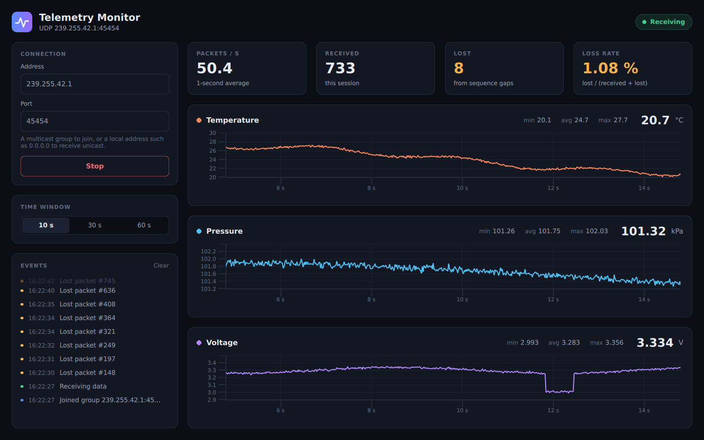

# Qt Telemetry Monitor

Real-time UDP telemetry monitor built with Qt 6 and C++17.

A simulator streams sensor packets over UDP multicast. The monitor receives them on a worker thread, detects lost, duplicated and reordered packets from their sequence numbers, and plots every channel live.



## Features

- **UDP multicast or unicast**, received and decoded on a dedicated worker thread
- **Packet-loss detection** from sequence numbers: gaps, duplicates, late (reordered) packets, sender restarts and 32-bit wraparound
- **Batched updates**: the receiver hands results to the UI every 50 ms as a single queued signal, so the interface stays smooth at 1000 packets/s
- **Live charts**, one per channel, with a 10 / 30 / 60 s window and auto-scaling axes that snap to round tick values
- **Statistics**: packets per second, received, lost, loss rate, and running min / avg / max per channel
- **Stale-data detection**: the status changes to *Signal lost* after 2 s without data
- **Event log** of losses, restarts, invalid datagrams and connection changes
- **Simulator** with an exact send rate and configurable packet loss
- **Tests** for the packet codec, sequence tracking, models, receiver and controller (Qt Test, 6 suites)

## Architecture

```
telemetry-sim ──UDP──▶ UdpReceiver                      worker thread
                         decode → SequenceTracker → batch
                              │
                              │  ReceiverBatch every 50 ms (queued signal)
                              ▼
                       TelemetryController              GUI thread
                         ├─ ChannelModel          values, min/avg/max, axis ranges
                         ├─ EventLogModel         event list
                         └─ QXYSeries::replace()  charts
                              │
                              ▼
                         QML (display only)
```

```
common/      wire format (TelemetryPacket) and SequenceTracker, shared by both apps
simulator/   telemetry-sim, the packet generator
monitor/     telemetry-monitor: C++ in src/, QML in qml/
tests/       Qt Test suites
```

### Wire format

Each datagram is 28 bytes, big-endian:

| Offset | Field         | Type     | Notes                         |
|-------:|---------------|----------|-------------------------------|
| 0      | magic         | `uint32` | `TLM1` (0x544C4D31)           |
| 4      | sequence      | `uint32` | wraps from 0xFFFFFFFF to 0    |
| 8      | timestampMs   | `int64`  | sender clock, ms since epoch  |
| 16     | channels[3]   | `float`  | temperature, pressure, voltage |

Datagrams with the wrong size or magic are counted and logged, never plotted.

## Design decisions

**Receiving on a worker thread.** Socket reads and decoding never compete with rendering. The GUI thread only ever sees finished batches.

**Batching every 50 ms.** One signal per packet at 1000 Hz would mean 1000 queued events and 1000 rounds of QML binding updates per second. Batching caps UI work at 20 updates per second whatever the packet rate, and 50 ms is too short to notice on a chart.

**Serial-number arithmetic for sequences.** The forward distance is `sequence - last` in unsigned 32-bit arithmetic, so wraparound needs no special case. A distance in the upper half of the range means the packet is *behind*: a little behind is a late packet (ignored, so it is not counted twice), far behind means the sender restarted (resync instead of discarding everything until the old number is reached again).

**Sessions.** Every `start()` gets a new session id that the receiver echoes in each batch, so batches from a previous run that are still in the event queue are discarded.

**Charts are fed from C++.** Each batch updates a series with one `QXYSeries::replace()` call instead of appending points one by one from QML. The controller keeps 60 s of history, so switching the time window is instant.

**Axes with hysteresis.** A y-axis only rescales when data leaves its range or the range becomes more than three times wider than the data, and it snaps to 1-2-5 tick intervals. The axes don't twitch with every sample, and labels are round numbers.

**QML is display only.** All state lives in the controller and the models, which are tested without a GUI.

**Rate scheduling by elapsed time.** The simulator computes how many packets are due from a monotonic clock instead of counting timer ticks. The average rate is exact even when 1000 / rate is not a whole number of milliseconds. After a stall (the machine slept, a debugger paused it) it skips ahead and sends at most one second of backlog instead of a huge burst.

**A static QML module.** All monitor code lives in a static library with its QML module, so the tests link exactly the code the application runs.

## Build

Requirements: Qt 6.11 or newer (Core, Network, Quick, Quick Controls, Graphs, Test), CMake 3.21+ and a C++17 compiler. Developed with MSVC 2022 on Windows; also builds with GCC on Linux.

In Qt Creator, open `CMakeLists.txt` and pick a Qt 6.11+ kit. From the command line:

```
cmake -B build -DCMAKE_PREFIX_PATH=C:/Qt/6.11.0/msvc2022_64
cmake --build build --config Release
```

## Run

Start the simulator, then the monitor:

```
telemetry-sim --rate 50 --drop 2
telemetry-monitor --start
```

| `telemetry-sim` option | Default        | Description                                  |
|------------------------|----------------|----------------------------------------------|
| `-a, --address`        | `239.255.42.1` | Destination: multicast group or unicast host |
| `-p, --port`           | `45454`        | Destination UDP port                         |
| `-r, --rate`           | `50`           | Packets per second (1 to 1000)               |
| `-d, --drop`           | `0`            | Percentage of packets to skip, to simulate loss |

| `telemetry-monitor` option | Description                                             |
|----------------------------|---------------------------------------------------------|
| `-s, --start`              | Start listening as soon as the window opens             |
| `-a, --address`            | Multicast group to join, or local address to listen on  |
| `-p, --port`               | UDP port                                                |

For unicast, send to `127.0.0.1` and listen on `127.0.0.1` or `0.0.0.0`:

```
telemetry-sim --address 127.0.0.1
telemetry-monitor --address 0.0.0.0 --start
```

On Windows, allow the monitor through the firewall on private networks the first time it runs, or the packets won't arrive.

## Tests

```
ctest --test-dir build -C Release --output-on-failure
```

On Windows, Qt's `bin` folder must be on `PATH` when running the tests from the command line (Qt Creator handles this for you).

## License

GPL-3.0. Qt Graphs is available under the GPL-3.0 or a commercial license, so this project uses the GPL.
